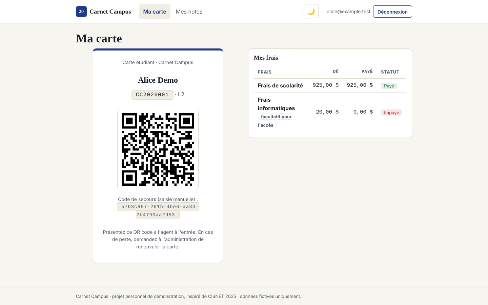
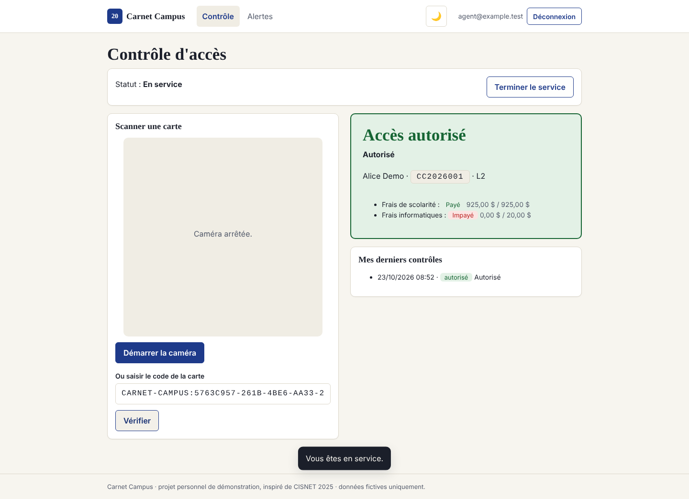

# Carnet Campus

**Notes, frais et contrôle d'accès par QR code pour un établissement, dans une seule application web.**

> **Projet personnel de démonstration de compétences, pas un projet académique.**
> Carnet Campus est inspiré de **CISNET 2025** et de mon projet de L2 (portail « Universe Security » en PHP/MySQL).
> C'est aussi l'évolution de [Carnet](https://github.com/Jevainbkg/Carnet_application_de_gestion_de_notes_pour_eleves_ou_etudiants), mon gestionnaire de notes.
> Il n'est affilié à aucun établissement. Toutes les données sont fictives.

| Étudiant : carte QR et frais | Agent : contrôle d'accès |
|---|---|
|  |  |

## Fonctionnalités

| Rôle | Ce qu'il peut faire |
|---|---|
| **Étudiant** | Rattacher son compte avec le code remis par l'administration ; carte QR personnelle ; état de ses frais (payé, acompte, impayé) ; relevé de notes avec moyenne pondérée et pourcentages, en lecture seule |
| **Agent de sécurité** | Prendre ou terminer son service ; scanner une carte à la caméra (ou saisir son code) ; verdict immédiat « autorisé / refusé » avec motif ; historique de ses contrôles ; alertes (créer, résoudre) |
| **Enseignant** | Gérer ses matières et coefficients ; saisir les notes de ses matières (0 à 20) |
| **Administrateur** | Inscrire les étudiants ; enregistrer les paiements ; définir les types de frais exigés pour l'accès ; attribuer les rôles ; renouveler une carte perdue ; révoquer un accès ; journal des contrôles et alertes |

Pour tous les rôles : mode jour / nuit, interface mobile d'abord, impression du relevé en PDF.

## Sécurité

- Authentification Supabase (mots de passe hachés, confirmation par e-mail).
- **Row Level Security** sur chaque table : un étudiant ne voit que ses données ; un enseignant ne touche qu'à ses matières ; un agent **ne peut lister ni les étudiants ni les paiements**.
- Le QR code contient un **jeton opaque révocable**, jamais le matricule. L'agent obtient uniquement la fiche scannée via la fonction `verify_card`, qui journalise chaque contrôle.
- Les rôles sont attribués par l'administrateur via une fonction contrôlée ; personne ne peut s'auto-promouvoir.
- CSP stricte et en-têtes de sécurité (`vercel.json`) ; aucun secret dans le dépôt.

## Ce qui a changé par rapport au projet de L2

| Projet L2 (PHP/MySQL) | Carnet Campus |
|---|---|
| Mots de passe en clair, accès MySQL `root` dans le code | Supabase Auth, aucun secret dans le dépôt |
| Pages protégées par un matricule dans l'URL | Politiques RLS dans la base |
| Scan non fonctionnel (variable inexistante, recherche par index) | Scan → `verify_card` → verdict + contrôle journalisé |
| L'agent recevait les paiements de tous les étudiants | L'agent ne voit que la carte scannée |
| QR = matricule, PNG écrits sur le disque | QR généré dans le navigateur, jeton révocable |
| Pas de gestion des notes | Module notes hérité de Carnet (matières, coefficients, moyenne pondérée) |

## Stack

HTML, CSS, JavaScript (modules ES, sans framework ni build) · Supabase (Postgres, Auth, RLS) · Vercel · [qrcode-generator](https://github.com/kazuhikoarase/qrcode-generator) et [html5-qrcode](https://github.com/mebjas/html5-qrcode), chargés depuis jsDelivr.

## Démarrer

1. Créer un projet Supabase et exécuter `supabase/schema.sql` dans le SQL Editor (idempotent).
2. Renseigner l'URL et la clé **publishable** (ou anon) dans `app/js/config.js`. Jamais la clé `service_role`.
3. `npm run dev` puis ouvrir l'adresse affichée. Le **premier compte créé** peut devenir administrateur depuis l'écran d'accueil.

Procédure complète de mise en ligne : [docs/deploiement.md](docs/deploiement.md).

## Tests

| Commande | Contenu | Résultat |
|---|---|---|
| `npm test` | Règles métier (moyenne, frais, QR, validations) | 10/10 |
| `npm run test:db` | Schéma et RLS sur un Postgres local avec une émulation de Supabase | 17/17 |
| `npm run test:ui` | Parcours des 4 rôles dans Chromium (Playwright) avec un faux Supabase | 16/16 |

## Documentation

- [Cahier des charges](docs/cahier-des-charges.md)
- [Prompt d'exécution](docs/prompt-execution.md)
- [Rapport de développement](docs/rapport-developpement.md)
- [Rapport de déploiement](docs/rapport-deploiement.md)

## Licence et crédits

Code © 2026 Jevain Bokwabgo Wisomi. Projet personnel ; inspiré de CISNET 2025. Les noms, matricules et paiements présentés sont fictifs.
